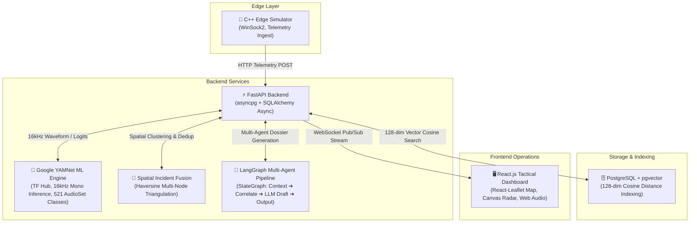

# 🛡️ EchoGuard: Tactical Bioacoustic Defense & Threat Detection Grid

**EchoGuard** is an end-to-end bioacoustic threat monitoring and tactical defense platform designed for real-time deforestation, illegal poaching, and acoustic anomaly detection in conservation zones (e.g., the Amazon Rainforest Basin).

---

## 🏗️ Architecture Overview



### Component Breakdown:
* **Edge Layer (`/edge_simulator`)**: High-performance, memory-safe C++ acoustic node telemetry generator transmitting bioacoustic features, battery states, and sensor health metrics over HTTP sockets.
* **ML Bioacoustic Engine (`/backend/app/services/audio_classifier.py`)**: Google YAMNet model from TensorFlow Hub performing inference on 16kHz mono audio waveforms across 521 AudioSet classes, filtering predictions down to mapped threat signatures (`CHAINSAW`, `GUNSHOT`, `ILLEGAL_VESSEL`, `VEHICLE_ENGINE`, `BLAST_FISHING`) and emitting 128-dimensional unit-normalized embeddings for pgvector.
* **Multi-Agent Orchestration (`/backend/app/services/langgraph.py`)**: Real LangGraph `StateGraph` executing a 4-stage pipeline (`retrieve_context` -> `correlate_nearby` -> `draft_report` with LLM reasoning -> `output`) generating dynamic ranger dispatch dossiers.
* **Spatial-Temporal Incident Fusion (`/backend/app/services/clustering.py`)**: Haversine distance engine that correlates nearby acoustic hits within a 650m radius and 90-second window into triangulated incident clusters.
* **Vector Similarity Database (`/backend/app/db`)**: PostgreSQL with the `pgvector` extension for 128-dimensional cosine distance similarity queries.
* **Geospatial & Tactical Frontend (`/frontend`)**: Modern React + Vite defense dashboard featuring:
  - **Live Monitor (`radar`)**: Real-time 360-degree radar sweep, live acoustic alert feed, interactive spectrogram analyzer, and waveform telemetry.
  - **Drop a Sound (`forest`)**: Interactive 2D canopy simulation allowing operators to drop real audio/video clips into the forest grid, computing acoustic attenuation and SNR across all listening nodes against pink noise.
  - **Tactical Map (`map`)**: Interactive `react-leaflet` geospatial map with Esri satellite imagery and CartoDB dark canvas, rendering sensor nodes and animated pulsing radar rings on active threat detections.
  - **Incident Clusters (`clusters`)**: Multi-node spatial-temporal fusion (Haversine 650m / 90s window) merging concurrent hits with LangGraph multi-agent ranger dossier generation.
  - **Sensor Fleet (`swarm`)**: Real-time battery status, solar charging indicators, telemetry timestamps, and coordinates for all active acoustic nodes.
  - **Similar Sounds (`vector-search`)**: Vector similarity search console querying 128-dimensional acoustic embeddings in PostgreSQL using `pgvector`.
  - **Verify Audio (`sandbox`)**: Acoustic forensics sandbox with direct audio upload, YAMNet spectrogram visualization, and confidence diagnostics.

---

## 🗄️ Database Setup (one time)

EchoGuard stores alerts in PostgreSQL and uses the **pgvector** extension for the "Similar sounds" search. The backend reads four settings (server, user, password, database name) from `backend/.env`; if there is no `.env` it uses `localhost`, user `user`, password `password`, database `echoguard`, port 5432.

1. **Start PostgreSQL with pgvector.** The simplest way is Docker, which already includes pgvector:
   ```
   docker run --name echoguard-db -e POSTGRES_USER=user -e POSTGRES_PASSWORD=password -e POSTGRES_DB=echoguard -p 5432:5432 -d pgvector/pgvector:pg16
   ```
   If you run your own PostgreSQL instead, create a database called `echoguard` and make sure the pgvector extension is installed on that server.
2. **Settings (optional).** Copy `backend/.env.example` to `backend/.env` and change the values if yours differ. Never commit `.env`.
3. **Create the tables.** From `backend/` with the virtual environment active:
   ```
   python init_db.py
   ```
   It enables pgvector and creates the `threat_alerts` table. It is safe to run again. If it says *permission denied to create extension*, a database administrator must run this once, then run `init_db.py` again:
   ```
   psql -U postgres -d echoguard -c "CREATE EXTENSION IF NOT EXISTS vector;"
   ```

Incident merging keeps its state in memory, so merged incidents are cleared when the backend restarts. Stored alerts are not.

## 🚀 Quick Start

### 1. One-Click Launch (Windows)
```cmd
start_echoguard.bat
```

### 2. Manual Startup

#### Backend (FastAPI):
```bash
cd backend
python -m venv venv
venv\Scripts\activate
pip install -r requirements.txt
python download_yamnet.py
python init_db.py
uvicorn app.main:app --reload --port 8000
```
* **Swagger API Docs**: `http://127.0.0.1:8000/docs`
* **Health Endpoint**: `http://127.0.0.1:8000/health`

#### Frontend (React + Vite):

> Fonts (IBM Plex Sans, IBM Plex Mono and Newsreader) are installed from npm and bundled with the app, so run `npm install` in `frontend/` after updating. No internet connection is needed to load them.

```bash
cd frontend
npm install
npm run dev
```
* **Tactical Dashboard**: `http://localhost:5173`

#### C++ Edge Simulator:
```cmd
cd edge_simulator
build.bat
.\bin\edge_simulator.exe
```

---

## 🌲 Drop a Sound (audio and video simulation)

Instead of generating a fake signal with a button, drop a **real audio or video clip** (mp3, wav, mp4, ...) onto the 2D forest view ("Drop a sound" tab) and the system works out what each sensor hears.

1. The backend decodes the clip to 16 kHz mono (video files are supported through ffmpeg, bundled by `imageio-ffmpeg`) and classifies every 2-second window with the same classifier used everywhere else (YAMNet when loaded).
2. The drop point on the forest becomes the sound source. For every sensor the backend computes the distance, then the signal-to-noise ratio: sound drops about 6 dB each time the distance doubles, plus a forest absorption term, against pink background noise.
3. A sensor whose signal is quieter than the background noise cannot detect it. Every other sensor classifies what it hears, and those at or above 50% confidence raise a normal alert (stored, clustered and broadcast to the live dashboard).
4. The page shows the waveform, the per-window verdicts, the top classifier labels, and a table of what each sensor heard, with the strongest listener highlighted.

**Real:** the clip and its classification. **Assumed (constants in `backend/app/services/audio_simulation.py`):** loudness at the source, how far sound carries, and the noise level. These are simulation parameters, not field measurements.

API: `POST /api/v1/simulate/audio-drop` (multipart: `file`, `nodes`, `source_lat`, `source_lon`, `loudness`, `send_alerts`) and `GET /api/v1/simulate/coverage`.

If the page shows "Real YAMNet is not loaded", the results come from a simple signal heuristic and should not be used to judge the model.

## 🧪 Testing & Evaluation

### 1. Automated Unit Tests
Run the comprehensive `pytest` test suite:
```bash
cd backend
pytest tests
```

### Check that the real model is running, and score your own clips

```
cd backend
python verify_yamnet.py
```
It says whether real YAMNet is loaded and, if not, why and how to fix it. The same status is at `GET /api/v1/audio/model/info` (`using_real_yamnet`, `load_error`).

To measure how well the system tells sounds apart, use the 29 pre-packaged evaluation clips in `backend/clips/` or provide your own labelled audio clips in sub-folders:

```
clips/chainsaw/saw1.mp3
clips/gunshot/shot1.wav
clips/vehicle/truck.mp4
clips/illegal_vessel/boat.mp3
clips/none/birdsong.mp3      <- sounds with NO threat: birdsong, rain, wind, frogs ...

python evaluate_clips.py clips
```
*(You can also download additional test clips automatically using `python download_dataset.py`)*

It writes `evaluation_results.md` and `.csv` with accuracy, per-class recall and precision, the false-alarm rate on non-threat clips, and which clips it got wrong. If real YAMNet is not loaded, the report says so, and its numbers must not be quoted as the model's accuracy.


### 2. FSC22 Dataset Benchmark Evaluation
Evaluate the YAMNet pipeline against the FSC22 (Forest Sound Classification) dataset:
```bash
cd backend
python evaluate_fsc22.py --dataset_dir ./data/fsc22
```
*(To download the real Kaggle benchmark dataset: `kaggle datasets download -d irmiot22/fsc22-dataset`)*

---

## 📦 Tech Stack
* **Backend**: Python 3.11+, FastAPI, SQLAlchemy (Async), PostgreSQL, pgvector, asyncpg, TensorFlow Hub (YAMNet), LangGraph, LangChain
* **Frontend**: React.js, Vite, Leaflet, React-Leaflet, Web Audio API, Lucide Icons, Canvas & SVG Radar
* **Edge**: C++ WinSock2 HTTP Client, Acoustic Telemetry Simulator
