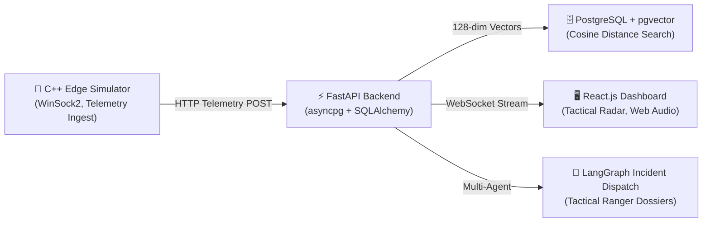

# 🛡️ EchoGuard: Tactical Bioacoustic Defense & Threat Detection Grid

**EchoGuard** is an end-to-end bioacoustic threat monitoring and tactical defense platform designed for real-time deforestation, illegal poaching, and acoustic anomaly detection in conservation zones (e.g., the Amazon Rainforest Basin).

---

## 🏗️ Architecture Overview



* **Edge Layer (`/edge_simulator`)**: High-performance, memory-safe C++ acoustic node telemetry generator transmitting bioacoustic features and sensor health metrics over HTTP sockets.
* **Backend Layer (`/backend`)**: High-concurrency async FastAPI service integrating PostgreSQL `pgvector` for 128-dimensional acoustic similarity search, WebSocket real-time pub/sub streaming, and LangGraph tactical incident orchestration.
* **Frontend Layer (`/frontend`)**: Modern React + Vite defense dashboard with real-time geospatial radar sweeping, Web Audio API acoustic alarm synthesizer, spectrogram inspection, and vector similarity explorer.

---

## 🚀 Quick Start

### 1. One-Click Launch (Windows)
```cmd
start_echoguard.bat
```

### 2. Manual Startup

#### Backend (FastAPI):
```bash
cd backend
python -m venv venv
venv\Scripts\activate
pip install -r requirements.txt
uvicorn app.main:app --reload --port 8000
```
* **Swagger API Docs**: `http://127.0.0.1:8000/docs`
* **Health Endpoint**: `http://127.0.0.1:8000/health`

#### Frontend (React + Vite):
```bash
cd frontend
npm install
npm run dev
```
* **Tactical Dashboard**: `http://localhost:5173`

#### C++ Edge Simulator:
```cmd
cd edge_simulator
build.bat
.\bin\edge_simulator.exe
```

---

## 🧪 Testing & Verification

Run the comprehensive unit test suite:
```bash
cd backend
pytest tests
```

---

## 📦 Tech Stack
* **Language & Runtime**: Python 3.11+, C++14, JavaScript (ES6+ / React 18)
* **API & DB**: FastAPI, SQLAlchemy (Async), PostgreSQL, pgvector, asyncpg
* **Frontend**: React.js, Vite, Web Audio API, Lucide Icons, Canvas & SVG Radar
* **Edge**: C++ WinSock2 HTTP Client, Acoustic Telemetry Simulator
