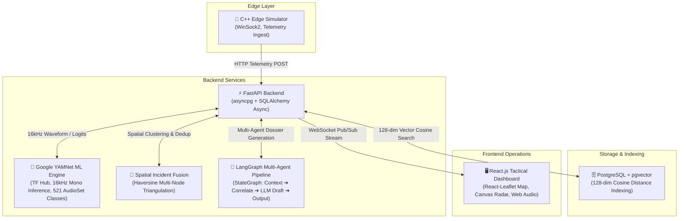

# 🛡️ EchoGuard: Tactical Bioacoustic Defense & Threat Detection Grid

**EchoGuard** is an end-to-end bioacoustic threat monitoring and tactical defense platform designed for real-time deforestation, illegal poaching, and acoustic anomaly detection in conservation zones (e.g., the Amazon Rainforest Basin).

---

## 🏗️ Architecture Overview



### Component Breakdown:
* **Edge Layer (`/edge_simulator`)**: High-performance, memory-safe C++ acoustic node telemetry generator transmitting bioacoustic features, battery states, and sensor health metrics over HTTP sockets.
* **ML Bioacoustic Engine (`/backend/app/services/audio_classifier.py`)**: Google YAMNet model from TensorFlow Hub performing inference on 16kHz mono audio waveforms across 521 AudioSet classes, filtering predictions down to mapped threat signatures (`CHAINSAW`, `GUNSHOT`, `ILLEGAL_VESSEL`, `VEHICLE_ENGINE`, `BLAST_FISHING`) and emitting 128-dimensional unit-normalized embeddings for pgvector.
* **Multi-Agent Orchestration (`/backend/app/services/langgraph.py`)**: Real LangGraph `StateGraph` executing a 4-stage pipeline (`retrieve_context` -> `correlate_nearby` -> `draft_report` with LLM reasoning -> `output`) generating dynamic ranger dispatch dossiers.
* **Spatial-Temporal Incident Fusion (`/backend/app/services/clustering.py`)**: Haversine distance engine that correlates nearby acoustic hits within a 650m radius and 90-second window into triangulated incident clusters.
* **Vector Similarity Database (`/backend/app/db`)**: PostgreSQL with the `pgvector` extension for 128-dimensional cosine distance similarity queries.
* **Geospatial & Tactical Frontend (`/frontend`)**: Modern React + Vite defense dashboard featuring:
  - **Tactical Map**: Interactive `react-leaflet` geospatial map with Esri satellite imagery and CartoDB dark canvas, rendering sensor nodes and animated pulsing radar rings on active threat detections.
  - **Tactical Radar**: Real-time 360-degree radar sweeping grid with active blip tracking.
  - **Verification Sandbox**: Direct audio file upload with YAMNet spectrogram visualization and confidence diagnostics.
  - **Incident Fusion Console**: Multi-node triangulation metrics and noise elimination ratios.
  - **Vector Similarity Search**: pgvector acoustic distance query console.

---

## 🚀 Quick Start

### 1. One-Click Launch (Windows)
```cmd
start_echoguard.bat
```

### 2. Manual Startup

#### Backend (FastAPI):
```bash
cd backend
python -m venv venv
venv\Scripts\activate
pip install -r requirements.txt
uvicorn app.main:app --reload --port 8000
```
* **Swagger API Docs**: `http://127.0.0.1:8000/docs`
* **Health Endpoint**: `http://127.0.0.1:8000/health`

#### Frontend (React + Vite):
```bash
cd frontend
npm install
npm run dev
```
* **Tactical Dashboard**: `http://localhost:5173`

#### C++ Edge Simulator:
```cmd
cd edge_simulator
build.bat
.\bin\edge_simulator.exe
```

---

## 🧪 Testing & Evaluation

### 1. Automated Unit Tests
Run the comprehensive `pytest` test suite:
```bash
cd backend
pytest tests
```

### 2. FSC22 Dataset Benchmark Evaluation
Evaluate the YAMNet pipeline against the FSC22 (Forest Sound Classification) dataset:
```bash
cd backend
python evaluate_fsc22.py --dataset_dir ./data/fsc22
```
*(To download the real Kaggle benchmark dataset: `kaggle datasets download -d irmiot22/fsc22-dataset`)*

---

## 📦 Tech Stack
* **Backend**: Python 3.11+, FastAPI, SQLAlchemy (Async), PostgreSQL, pgvector, asyncpg, TensorFlow Hub (YAMNet), LangGraph, LangChain
* **Frontend**: React.js, Vite, Leaflet, React-Leaflet, Web Audio API, Lucide Icons, Canvas & SVG Radar
* **Edge**: C++ WinSock2 HTTP Client, Acoustic Telemetry Simulator
