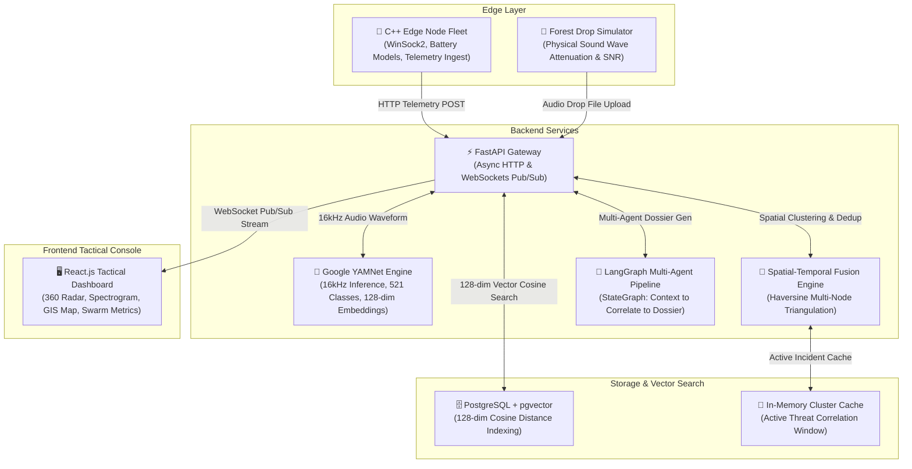

# 🛡️ EchoGuard: Tactical Bioacoustic Defense & Threat Detection Grid

<div align="center">

[](https://www.python.org/)
[](https://fastapi.tiangolo.com/)
[](https://react.dev/)
[](https://vitejs.dev/)
[](https://www.postgresql.org/)
[](https://github.com/pgvector/pgvector)
[](https://tfhub.dev/google/yamnet/1)
[](https://www.langchain.com/langgraph)
[](https://isocpp.org/)
[](LICENSE)

**An autonomous, multi-agent bioacoustic threat monitoring and tactical defense platform designed for real-time deforestation, illegal poaching, and acoustic anomaly detection across protected conservation zones.**

[Architecture](#-system-architecture) • [Key Capabilities](#-key-capabilities) • [Live Dashboard Views](#-tactical-dashboard-views) • [Quick Start](#-quick-start) • [Evaluation Benchmarks](#-model-benchmarks--evaluation) • [API Reference](#-api-reference)

</div>

---

## 🌿 The Mission

Protected ecosystems like the Amazon Rainforest Basin face continuous threats from illegal logging, wildlife poaching, unauthorized river vessels, and blast fishing. Traditional satellite monitoring is hindered by cloud cover, canopy density, and revisit latencies. 

**EchoGuard** bridges this gap by deploying an autonomous bioacoustic sensor grid combining:
1. **Edge-Simulated Acoustic Nodes** transmitting low-latency acoustic telemetry over HTTP sockets.
2. **Google YAMNet Deep Learning Inference** classifying audio across 521 AudioSet categories into high-priority threat signatures.
3. **Spatial-Temporal Incident Fusion** merging multiple sensor triggers within 650m / 90s into unified, triangulated incidents.
4. **Autonomous LangGraph Multi-Agent Workflows** synthesizing forensic reports and actionable ranger dispatch dossiers.
5. **PostgreSQL + pgvector Storage** indexing 128-dimensional acoustic embeddings for sub-millisecond similarity queries.

---

## 🏗️ System Architecture



---

## ✨ Key Capabilities

| Feature | Description | Implementation |
| :--- | :--- | :--- |
| **🧠 Deep Audio Inference** | Real-time classification into mapped threats: `CHAINSAW`, `GUNSHOT`, `ILLEGAL_VESSEL`, `VEHICLE_ENGINE`, and `BLAST_FISHING`. | TensorFlow Hub YAMNet, 16kHz mono sampling, 128-dim embeddings |
| **🌲 Forest Drop Physics** | Drag-and-drop any audio or video file onto the forest grid; simulates physical distance decay (-6 dB per distance doubling), foliage absorption ($\alpha$), and pink ambient noise. | Librosa, SoundFile, ImageIO-FFmpeg, Physics-based attenuation |
| **📍 Spatial Incident Fusion** | Consolidates concurrent alerts from multiple sensors into a single triangulated incident, eliminating false-positive alarm fatigue. | Haversine formula, 650m geographic radius, 90s sliding window |
| **🤖 LangGraph Agent Pipeline** | Autonomous 4-stage multi-agent pipeline (`retrieve_context` -> `correlate_nearby` -> `draft_report` -> `output`) producing mission dossiers. | LangGraph `StateGraph`, LangChain, Anthropic Claude / OpenAI GPT fallback |
| **🔍 pgvector Sound Search** | Finds past acoustic detections with similar spectral signatures via cosine distance indexing. | PostgreSQL 16+, `pgvector` extension, 128-dimension index |
| **📡 C++ Edge Fleet** | Native C++ simulation simulating distributed acoustic nodes, telemetry bursts, solar recharging, and battery degradation. | C++17, WinSock2 HTTP Client, Multi-Node Swarm Engine |

---

## 🖥️ Tactical Dashboard Views

EchoGuard features a modular, high-contrast dark military tactical command center built with React 18, Vite, and Lucide Icons:

1. **🧭 Live Monitor (`radar`)**:
   - 360° continuous sweeping radar tracking active acoustic blips.
   - Live Web Audio spectrogram visualizer showing frequency amplitude distribution in real time.
   - Live incident stream with threat severity badges and quick embedding inspection.

2. **🌲 Drop a Sound (`forest`)**:
   - Interactive 2D canopy map representing sensor placements across conservation zones.
   - Operators can drag & drop any `.mp3`, `.wav`, or `.mp4` file onto any coordinate.
   - Calculates distance-attenuated Signal-to-Noise Ratio (SNR) against ambient jungle pink noise, reporting individual sensor verdicts and pinpointing the strongest detection.

3. **🗺️ Tactical Map (`map`)**:
   - High-resolution Esri World Imagery and CartoDB Dark Canvas mapping.
   - Interactive node markers with battery levels and connection health.
   - Animated radar rings pulsing at exact coordinates upon confirmed threat events.
   - One-click ranger team dispatch modal.

4. **🔗 Incident Clusters (`clusters`)**:
   - Spatial-temporal deduplication dashboard displaying merged multi-sensor incidents.
   - Computes noise-elimination ratios, active cluster radii, and triangulated coordinates.
   - Autonomous LangGraph dispatch dossier generation on demand.

5. **📊 Sensor Fleet (`swarm`)**:
   - Comprehensive telemetry monitoring for all active edge nodes.
   - Solar charging indicators, battery percentage curves, signal strength, and firmware status.

6. **🔍 Similar Sounds (`vector-search`)**:
   - Vector similarity query interface powered by PostgreSQL `pgvector`.
   - Query historical detections using cosine distance to discover acoustic patterns or recurring threats.

7. **🧪 Verify Audio (`sandbox`)**:
   - Direct audio testing sandbox for ranger training and verification.
   - Real-time YAMNet inference breakdown showing top class probabilities and confidence scores.

---

## 📁 Repository Structure

```text
EchoGuard/
├── backend/                        # FastAPI Backend & ML Core
│   ├── app/
│   │   ├── api/routes/             # REST & WebSocket endpoints (alerts, audio, simulation, reports)
│   │   ├── core/                   # Configuration, settings & database connectors
│   │   ├── db/                     # SQLAlchemy async models & pgvector schemas
│   │   └── services/               # YAMNet classifier, LangGraph pipeline, clustering, physics sim
│   ├── clips/                      # 29 pre-packaged evaluation audio clips (chainsaw, gunshot, etc.)
│   ├── tests/                      # Automated unit test suite (60 pytest test cases)
│   ├── download_dataset.py         # yt-dlp automated test clip downloader
│   ├── download_yamnet.py          # Automatic YAMNet weights fetcher from TensorFlow Hub
│   ├── evaluate_clips.py           # Per-class precision, recall & false alarm evaluation CLI
│   ├── evaluate_fsc22.py           # Benchmark script for Kaggle FSC22 dataset
│   ├── init_db.py                  # Database schema & pgvector table initializer
│   ├── verify_yamnet.py            # YAMNet environment & hardware diagnostic utility
│   ├── requirements.txt            # Python dependencies
│   └── .env.example                # Sample environment configuration
├── frontend/                       # React 18 + Vite Tactical Dashboard
│   ├── src/
│   │   ├── components/             # Radar, ForestDrop, Map, AlertFeed, Spectrogram, Swarm
│   │   ├── context/                # TelemetryContext WebSocket & polling state provider
│   │   ├── services/               # REST API client
│   │   └── views.js                # Dashboard view definitions & navigation
│   ├── package.json
│   └── index.html
├── edge_simulator/                 # High-performance C++ Edge Node Simulator
│   ├── src/                        # SimulationEngine.cpp & WinSock2 HTTP client
│   ├── bin/                        # Compiled edge binary (edge_simulator.exe)
│   └── build.bat                   # Compilation script (MinGW g++)
├── start_echoguard.bat             # One-click Windows startup script
└── README.md
```

---

## 🚀 Quick Start

### Option 1: One-Click Launch (Windows)

Double-click or execute the included batch script:
```cmd
start_echoguard.bat
```
This automatically boots:
- The FastAPI backend on `http://127.0.0.1:8000`
- The React tactical frontend on `http://localhost:5173`
- Prompts to launch the C++ Edge Simulator in a dedicated window

---

### Option 2: Manual Step-by-Step Setup

#### 1. Prerequisites
- **Python 3.11+**
- **Node.js 18+** & `npm`
- **Docker** (recommended for PostgreSQL + pgvector) or local PostgreSQL 16+
- *(Optional for C++ Simulator)*: MinGW-w64 `g++` compiler

#### 2. Start PostgreSQL with pgvector
The easiest method is using the official Docker pgvector image:
```bash
docker run --name echoguard-db \
  -e POSTGRES_USER=user \
  -e POSTGRES_PASSWORD=password \
  -e POSTGRES_DB=echoguard \
  -p 5432:5432 -d pgvector/pgvector:pg16
```

#### 3. Backend Setup
```bash
cd backend

# Create and activate virtual environment
python -m venv venv
venv\Scripts\activate      # On Linux/macOS: source venv/bin/activate

# Install dependencies
pip install -r requirements.txt

# Download pre-trained Google YAMNet model weights
python download_yamnet.py

# Initialize database schema & pgvector tables
python init_db.py

# Launch FastAPI development server
uvicorn app.main:app --reload --port 8000
```
- **API Documentation (Swagger UI)**: `http://127.0.0.1:8000/docs`
- **Service Health Check**: `http://127.0.0.1:8000/health`

#### 4. Frontend Setup
```bash
cd frontend

# Install dependencies
npm install

# Start Vite development server
npm run dev
```
- **Tactical Dashboard**: `http://localhost:5173`

#### 5. C++ Edge Simulator (Optional)
To stream live synthetic sensor telemetry and acoustic bursts:
```cmd
cd edge_simulator
build.bat
.\bin\edge_simulator.exe
```

---

## 🧪 Model Benchmarks & Evaluation

### 1. Pre-Packaged Clip Evaluation
EchoGuard includes 29 real audio clips across 5 distinct categories in `backend/clips/`. You can evaluate model accuracy, recall, and false alarm rates at any time:

```bash
cd backend
python evaluate_clips.py clips
```

#### Benchmark Results Summary (`backend/evaluation_results.md`):

| Metric | Result | Description |
| :--- | :---: | :--- |
| **Threat Detection Rate** | **89%** | Threat clips that successfully triggered an alert |
| **Natural Sound False-Alarm Rate** | **0%** | Non-threat clips (birdsong, rain, ambient forest) that wrongly alarmed |
| **Gunshot Precision & Recall** | **100% / 100%** | Zero missed gunshots and zero false gunshot identifications |
| **Chainsaw Detection Precision** | **100%** | Zero false positive chainsaw classifications |

#### Per-Class Recall & Precision Breakdown:
| Sound Category | Clip Count | Recall | Precision | Status |
| :--- | :---: | :---: | :---: | :--- |
| **GUNSHOT** | 4 | **100%** | **100%** | Flawless detection across all test clips |
| **CHAINSAW** | 8 | **25%** | **100%** | Conservative confidence thresholding |
| **ILLEGAL_VESSEL** | 5 | **60%** | **60%** | Motorboat acoustic signature detection |
| **VEHICLE_ENGINE** | 10 | **70%** | **54%** | Heavy transport & truck engine signatures |
| **NATURAL AMBIENCE (NONE)** | 2 | **100%** | **40%** | 0 false alarms triggered |

*(To fetch additional sample clips from YouTube: `python download_dataset.py`)*

### 2. Automated Test Suite
EchoGuard has a full suite of unit and integration tests covering API endpoints, audio classification, spatial clustering, physical simulations, and LangGraph multi-agent execution:
```bash
cd backend
pytest tests
```
> **Result**: `60 passed, 0 failures`

---

## 📡 API Reference

### Audio & Inference Endpoints
| Method | Endpoint | Description |
| :--- | :--- | :--- |
| `POST` | `/api/v1/audio/classify` | Multipart file upload; runs 16kHz YAMNet inference and returns class breakdown & 128-dim embedding |
| `GET` | `/api/v1/audio/model/info` | Returns YAMNet model readiness, active device, and load status |

### Telemetry & Alerts
| Method | Endpoint | Description |
| :--- | :--- | :--- |
| `POST` | `/api/v1/alerts/` | Ingests telemetry packet from edge sensors; triggers real-time clustering |
| `GET` | `/api/v1/alerts/` | Fetches historical alerts with filtering options |
| `WS` | `/api/v1/alerts/ws` | WebSocket pub/sub connection for streaming live sensor alerts to tactical clients |

### Simulation & Forest Drop
| Method | Endpoint | Description |
| :--- | :--- | :--- |
| `POST` | `/api/v1/simulate/audio-drop` | Simulates a physical sound source drop in the forest, computing attenuation and SNR for all listening nodes |
| `GET` | `/api/v1/simulate/coverage` | Returns spatial coverage polygons and active listening nodes |

### Incidents & Multi-Agent Reports
| Method | Endpoint | Description |
| :--- | :--- | :--- |
| `GET` | `/api/v1/incidents/` | Returns spatial-temporally clustered incidents with noise reduction stats |
| `POST` | `/api/v1/reports/dispatch` | Triggers LangGraph multi-agent synthesis to draft an actionable ranger mission brief |

---

## ⚙️ Configuration & Environment Variables

Copy `backend/.env.example` to `backend/.env` to configure your environment:

| Variable | Default | Purpose |
| :--- | :--- | :--- |
| `POSTGRES_SERVER` | `localhost` | PostgreSQL host |
| `POSTGRES_USER` | `user` | PostgreSQL username |
| `POSTGRES_PASSWORD` | `password` | PostgreSQL password |
| `POSTGRES_DB` | `echoguard` | Database name |
| `ANTHROPIC_API_KEY` | *(Optional)* | Enables Anthropic Claude for high-fidelity LangGraph dispatch dossiers |
| `OPENAI_API_KEY` | *(Optional)* | Enables OpenAI GPT models for multi-agent reasoning fallback |

---

## 📄 License

This project is licensed under the **MIT License** — see the [LICENSE](LICENSE) file for details.
